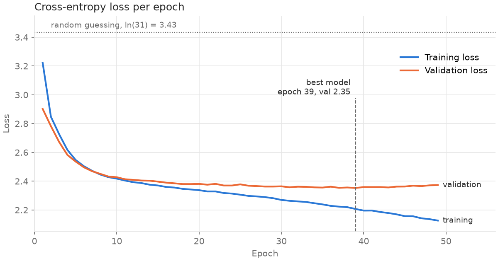

# D&D Name Generator

A small character-level language model that invents fantasy character names for the nine playable races in the D&D 5e Player's Handbook. It is built with Keras and TensorFlow and trained on about 1,900 names from D&D, Tolkien and other fantasy sources.

Sample output at temperature 0.8:

| Race | Generated names |
|---|---|
| Dragonborn | Shriax, Marithus, Sharash, Danaris |
| Dwarf | Kardin, Morgel, Kundil, Nolbar |
| Elf | Naeoro, Beledron, Anferio, Carenia |
| Gnome | Fredro, Gilgory, Bildy, Donigo |
| Half-elf | Mirelind, Pelandur, Danadar, Pseos |
| Half-orc | Stroth, Ghethwe, Mutkin, Kummlodakal |
| Halfling | Belboro, Murben, Bodskumbol, Pbranda |
| Human | Balathen, Halelwen, Lothora, Foreyla |
| Tiefling | Afrith, Barlis, Gelimos, Zymperopnas |

## Quick start

Tested with Python 3.12 and TensorFlow 2.21 on Windows, using the CPU. A trained model is included, so you can generate names without training first.

```bash
python -m venv .venv
.venv\Scripts\activate
pip install -r requirements.txt
python generate.py --race dwarf --count 10 --temperature 0.8
```

On macOS or Linux, activate the environment with `source .venv/bin/activate`.

Available races are `dragonborn`, `dwarf`, `elf`, `gnome`, `half-elf`, `half-orc`, `halfling`, `human` and `tiefling`.

To retrain the model on `data/raw/names.csv`:

```bash
python train.py
```

To run the tests:

```bash
pip install -r requirements-dev.txt
python -m pytest -v
```

## How it works

The model learns one task: given a race and the letters so far, predict the next letter. To generate a name, it samples a letter, feeds it back in, and repeats until it predicts the end of the name.

```
race  -> race embedding -> Dense -> the GRU's starting memory
chars -> char embedding -> GRU   -> Dropout -> Dense -> score for each possible next character
```

For the name "Bo", the training pairs are:

```
input:   START  b  o
target:  b      o  END
```

The model has 69,519 trainable parameters.

### Design decisions

- **Characters instead of words:** a name is a single word, so the useful patterns are the letter combinations inside it.
- **A GRU instead of a Transformer:** with only about 1,900 short names, a small recurrent network fits the data better. Transformers need much more data, and their main strength is long-range context, which short names don't have.
- **Race as the starting memory:** a learned race embedding sets the GRU's initial state, so each race begins a name from a different state.
- **Splitting by name:** the validation split is made over distinct names, not rows. A name listed under two races stays on one side, so the validation set contains no names the model trained on.
- **Controlling memorisation:** a small model, dropout and early stopping all make it harder for the model to simply repeat its training names.
- **Temperature sampling:** low temperatures give safer, more repetitive names, and high temperatures give stranger ones.
- **Filtering after generation:** each finished name is checked, and a rejected name is simply generated again, up to 100 times. Checking the finished name keeps the filter independent of the model, so it can be tested without TensorFlow.

### Output filter

`slm/name_filter.py` rejects two kinds of names:

- **Three identical letters in a row,** such as "Filllich". No name in the training data has this, so it is always a sampling mistake.
- **Names of dictators and leading Nazis,** such as Hitler or Stalin, from a fixed list. The check ignores capitalisation.

How often the filter steps in, for 270 names per temperature (30 per race):

| Temperature | Rejected | Examples |
|---:|---:|---|
| 0.8 (default) | 0 | |
| 1.5 | 0 | |
| 2.0 | 1 | Aaamerce |
| 3.0 | 4 | Byatzartyusss, Fcollluglddggqh |

At normal temperatures the model has learned to avoid triple letters, so the filter is a safety net for rare cases and high temperatures.

## Tests

The tests in `tests/` cover the tokenizer, loading and splitting the data, sampling and the filter. Among other things, they check that:

- encoding and then decoding a name gives back the same name
- the target is the input shifted by one position
- a name listed under two races never ends up in both the training and the validation set
- PAD and START are never sampled, and a very low temperature always picks the most likely character
- every banned name only uses characters the model can actually generate

## Data

`data/raw/names.csv` has the columns `name`, `surname`, `race` and `gender`. Only `name` and `race` are currently used for training. Rows that contain only a surname are skipped.

| Race | First names | Main sources |
|---|---:|---|
| Human | 432 | Tolkien, D&D, Baldur's Gate 1 and 2 |
| Elf | 298 | Tolkien, D&D, Baldur's Gate |
| Dwarf | 282 | Tolkien, D&D, Baldur's Gate |
| Halfling | 279 | Tolkien (Hobbits), D&D, Baldur's Gate |
| Gnome | 154 | D&D, Baldur's Gate 3 |
| Half-elf | 153 | Greek mythology, Tolkien, D&D, Baldur's Gate |
| Dragonborn | 145 | D&D, dragons from Skyrim, Game of Thrones, Tolkien, Eragon and mythology |
| Tiefling | 140 | D&D, Baldur's Gate |
| Half-orc | 62 | D&D, Baldur's Gate 3 |

Accents and royal title prefixes such as "Tar-" were removed. After removing duplicates, there are 1,938 unique name and race pairs.

### Data limitations

- **Accuracy:** many names were compiled from memory and have not been checked against the original books, so the list may contain errors in spelling, race or gender.
- **Coverage:** the list is not a complete record of any source or D&D edition.
- **Imbalance:** human has about seven times as many names as half-orc, and there are many more male than female names.
- **Unknown gender:** the value `any` in the `gender` column means unisex or unknown. All names taken from the Baldur's Gate 3 wiki are marked this way.
- **Creative substitutions:** Greek names stand in for half-elves, and dragon names stand in for dragonborn. These are project choices, not official D&D naming conventions.
- **Mixed styles:** sources within a race can sound very different, which may blur the style of generated names.

## Results

The data was split into 1,747 training names and 191 validation names.

| Epoch | Training loss | Validation loss |
|---:|---:|---:|
| 1 | 3.22 | 2.90 |
| 10 | 2.42 | 2.43 |
| 20 | 2.34 | 2.38 |
| 39 (best, saved) | 2.21 | 2.35 |
| 49 (stopped) | 2.13 | 2.37 |



The training loss keeps falling, while the validation loss levels off after about 20 epochs. From then on the model mainly improves on names it has already seen. Early stopping keeps the model from epoch 39, where the validation loss was lowest. The curve comes from a second training run with the same seed, which reproduced the saved model's numbers exactly.

A validation loss of 2.35 means the model is about as uncertain as choosing between 10 equally likely characters, compared with 31 if it had learned nothing.

Of 100 generated names per race at temperature 0.8, between 0% and 3% were exact copies of names in the dataset.

### Limitations of the results

- **The effect of race has not been measured.** Generated names look plausible, but races don't always sound clearly different. Dragonborn in particular doesn't sound clearly draconic.
- **There is no baseline yet.** The model has not been compared with a simpler approach, such as a character n-gram model.
- **Some output is garbled,** such as "Pbranda". The filter only catches triple letters, not names that are hard to pronounce for other reasons.
- **The sample is small.** The copy rate comes from a single run of 100 names per race.

## Next steps

- Retrain with shuffled race labels and compare the validation loss, to measure whether race really influences the names
- Compare against a character n-gram baseline
- Test the alternative of feeding the race in at every letter
- Add gender as a second label
- Expand the smaller groups, especially half-orc

## Project structure

```
├── data/raw/names.csv     # training data
├── checkpoints/           # trained model and tokenizer
├── slm/
│   ├── config.py          # settings and the list of races
│   ├── tokenizer.py       # converts characters to IDs and back
│   ├── dataset.py         # loads, splits and batches the names
│   ├── model.py           # the Keras model
│   └── name_filter.py     # rejects unwanted generated names
├── tests/                 # pytest tests
├── docs/loss_curve.png    # loss curve shown in this README
├── train.py               # trains the model
├── generate.py            # generates names
├── requirements.txt       # packages to run the project
└── requirements-dev.txt   # adds pytest for the tests
```

## Disclaimer

This is an unofficial, non-commercial learning project and is not affiliated with or endorsed by the owners of any source. Dungeons & Dragons, Baldur's Gate, The Lord of the Rings, Skyrim, Game of Thrones and Eragon belong to their respective rights holders.
